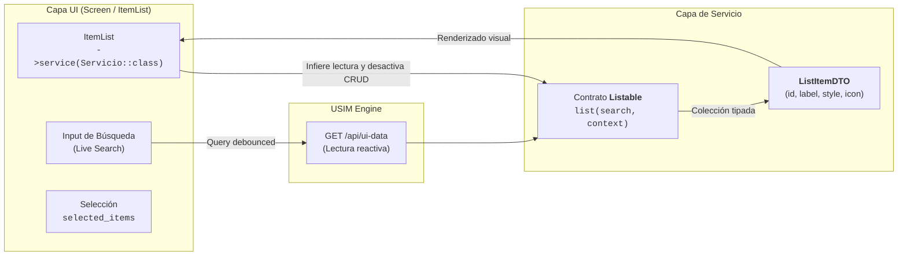
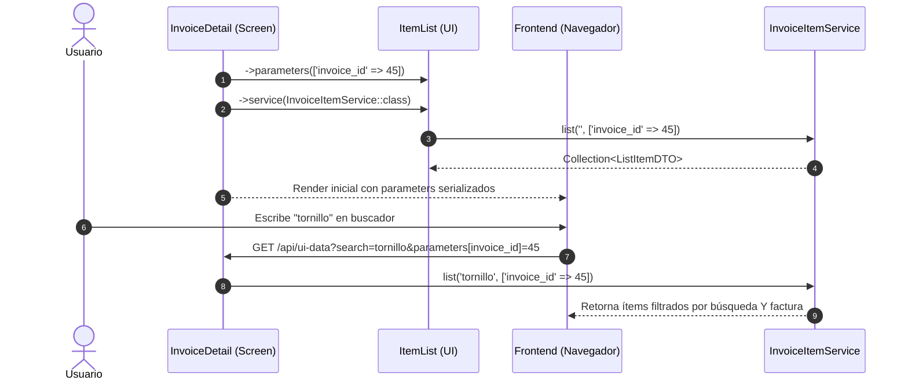
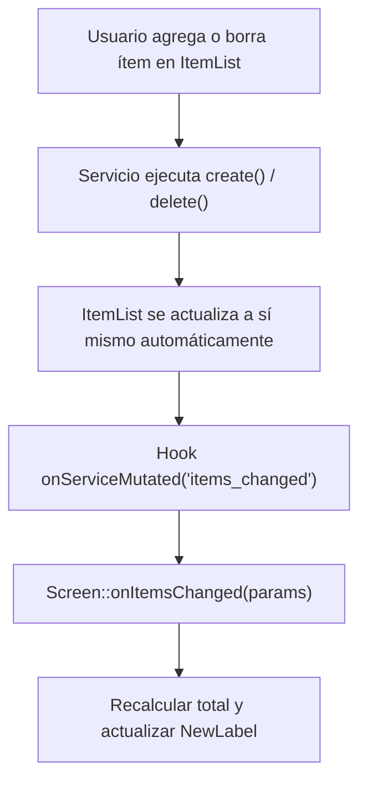

# Guidelines: Casos de Uso Prácticos de `ItemList`

Esta guía recopila los patrones de diseño y casos de uso recomendados para el componente `ItemList` en **USIM 2.12.1**, aprovechando la arquitectura de **Capability-Based Service Wiring**.

---

## 1. Fundamentos y Flujo de Trabajo

En USIM 2.12.1, `ItemList` se conecta directamente a servicios de dominio o aplicación que implementan contratos de capacidad segregados (`Listable`, `Creatable`, `Updatable`, `Deletable`, `BulkDeletable`) bajo `Idei\Usim\Contracts\ItemList`.



> [!NOTE]
> Las filas visuales son modeladas exclusivamente por `Idei\Usim\DTOs\ListItemDTO`, mientras que el estado de selección (`selected`) permanece centralizado en `ItemList` para preservar los elementos seleccionados a través de búsquedas remotas.

---

## 2. Caso de Uso 1: Lista de Solo Lectura Básica

Cuando se requiere mostrar un catálogo sin opciones de creación, edición o borrado.

### Implementación del Servicio
```php
namespace App\Services;

use App\Models\Product;
use Idei\Usim\Contracts\ItemList\Listable;
use Idei\Usim\DTOs\ListItemDTO;
use Idei\Usim\Enums\Style;
use Illuminate\Support\Collection;

class ProductCatalogService implements Listable
{
    public function list(string $search = '', array $context = []): Collection
    {
        return Product::query()
            ->when($search, fn ($q) => $q->where('name', 'like', "%{$search}%"))
            ->get()
            ->map(fn ($p) => ListItemDTO::make(
                id: $p->id,
                label: $p->name,
                subtitle: "Stock: {$p->stock} uds.",
                icon: 'box',
                style: $p->stock > 0 ? Style::DEFAULT : Style::MUTED,
                disabled: $p->stock === 0
            ));
    }
}
```

### Configuración en la `Screen`
```php
use App\Services\ProductCatalogService;
use Idei\Usim\UI;

$productsList = UI::itemList('products_list')
    ->service(ProductCatalogService::class)
    ->searchable(true)
    ->singleSelect();
```

> [!TIP]
> Dado que `ProductCatalogService` sólo implementa `Listable`, `ItemList` infiere automáticamente `creatable = false`, `editable = false` y `deletable = false`. No es necesario configurar permisos manualmente.

---

## 3. Caso de Uso 2: Lista Filtrada por Contexto / Clave Foránea (`invoice_id`)

Permite acotar los elementos listados según la entidad padre activa (por ejemplo, los ítems asociados a una factura).

### Flujo de Parámetros
El método `parameters(array $params)` propaga valores tanto en la carga inicial de backend como en las peticiones cliente vía `GET /api/ui-data`.



### Implementación del Servicio
```php
namespace App\Services;

use App\Models\InvoiceItem;
use Idei\Usim\Contracts\ItemList\Listable;
use Idei\Usim\DTOs\ListItemDTO;
use Illuminate\Support\Collection;

class InvoiceItemService implements Listable
{
    public function list(string $search = '', array $context = []): Collection
    {
        $invoiceId = $context['invoice_id'] ?? null;

        return InvoiceItem::query()
            ->when($invoiceId, fn ($q) => $q->where('invoice_id', $invoiceId))
            ->when($search, fn ($q) => $q->where('description', 'like', "%{$search}%"))
            ->get()
            ->map(fn ($item) => ListItemDTO::make(
                id: $item->id,
                label: $item->description,
                subtitle: "\${$item->unit_price} x {$item->quantity}",
                badge: "Total: \${$item->subtotal}"
            ));
    }
}
```

### Configuración en la `Screen`
```php
protected function startingUI(): Container
{
    $invoiceId = $this->active_invoice_id;

    $this->invoice_items
        ->parameters(['invoice_id' => $invoiceId])
        ->service(InvoiceItemService::class)
        ->searchable(true);

    return parent::startingUI();
}
```

---

## 4. Caso de Uso 3: Cambio Dinámico de Contexto y Refresco Programático

Ocurre cuando el usuario cambia la entidad seleccionada en otro componente (por ejemplo, en un `Select` de facturas) y la lista subordinada debe actualizarse de inmediato.

```php
public function onInvoiceChanged(array $params): void
{
    $selectedInvoiceId = $params['value'];

    // 1. Actualiza los parámetros permanentes
    // 2. Ejecuta refreshFromService() para recargar datos en el backend y emitir reload_token al cliente
    $this->invoice_items
        ->parameters(['invoice_id' => $selectedInvoiceId])
        ->refreshFromService();
}
```

### Diferencia entre Métodos de Recarga

| Método | Dónde ejecuta la consulta | Cuándo usarlo |
|---|---|---|
| `refreshFromService(array $context = [])` | **Backend de inmediato** durante el evento actual | Cuando necesitas los nuevos datos en el mismo ciclo de vida de la pantalla (actualiza `items` en memoria y emite `reload_token`). |
| `reload()` | **Frontend diferido** vía `GET /api/ui-data` | Cuando la `Screen` no necesita procesar los ítems y solo requiere que el cliente vuelva a pedir los datos. |

---

## 5. Caso de Uso 4: Sincronización Reactiva con la Pantalla (`onServiceMutated`)

Si el servicio implementa mutaciones (`Creatable`, `Updatable`, `Deletable`), `ItemList` gestiona el alta/baja/modificación por su cuenta. Sin embargo, la `Screen` suele requerir actualizar elementos externos (como el monto total o un contador de ítems).



### Configuración del Hook
```php
$this->invoice_items
    ->service(InvoiceItemService::class)
    ->onServiceMutated('invoice_items_changed');
```

### Handler en la `Screen`
```php
public function onInvoiceItemsChanged(array $params): void
{
    // $params contiene:
    // - 'operation': 'create' | 'update' | 'delete' | 'bulk_delete'
    // - 'selected': array de IDs seleccionados
    // - payload con la entidad afectada

    $newTotal = InvoiceItem::where('invoice_id', $this->active_invoice_id)->sum('subtotal');
    
    $this->lbl_invoice_total->value("Total Factura: \${$newTotal}");
}
```

---

## 6. Caso de Uso 5: Definición Declarativa en `.layout.yaml`

Para mantener la clase `Screen` limpia, la configuración del servicio y sus parámetros iniciales pueden declararse directamente en el archivo de layout YAML.

```yaml
name: invoice_detail_wrapper
appearance: card
grid:
  cols: 12
  gap: m
  children:
    - sel_invoice:
        span: 6
        on_change: invoice_changed

    - invoice_items:
        span: 12
        service: App\Services\InvoiceItemService
        searchable: true
        debounce: 300
        max_height: 350
        scrollbar: always
        selection_mode: single
        on_service_mutated: invoice_items_changed

    - lbl_invoice_total:
        span: 12
        style: primary
        size: large
```

> [!IMPORTANT]
> `ContainerLayoutLoader` otorga prioridad a la clave `service:`. Esto asegura que los contratos del servicio se inspeccionen primero, permitiendo que cualquier propiedad explícita en YAML (como `editable: false` o `searchable: true`) sobreescriba selectivamente el comportamiento inferido.

---

## 7. Referencia Rápida de la API

| Método | Descripción |
|---|---|
| `->service(string\|object $service)` | Vincula la clase o instancia del servicio y activa las capacidades detectadas. |
| `->parameters(array $params)` | Define el contexto/filtros enviados a `list($search, $context)`. |
| `->refreshFromService(array $ctx = [])` | Re-ejecuta `list()` en el backend y sincroniza el componente. |
| `->reload()` | Incrementa `reload_token` para forzar un re-fetch desde el cliente. |
| `->onServiceMutated(string $action)` | Registra el callback en la `Screen` tras cualquier mutación CRUD exitosa. |
| `->serviceFeedback(bool $enabled)` | Habilita o deshabilita los toasts automáticos tras mutaciones. |
| `->searchable(bool $enabled)` | Habilita la barra de búsqueda y el live search vía `/api/ui-data`. |

### Enlaces Relacionados
- Documentación del cableado de servicios: [ITEM_LIST_SERVICE_WIRING.md](../ITEM_LIST_SERVICE_WIRING.md)
- Layouts declarativos: [DECLARATIVE_LAYOUTS_AND_I18N.md](../DECLARATIVE_LAYOUTS_AND_I18N.md)
- Demostración completa: `App\UI\Screens\Demo\ItemListDemo` y `App\Services\Movie\SessionMovieCatalogService`
